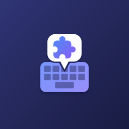
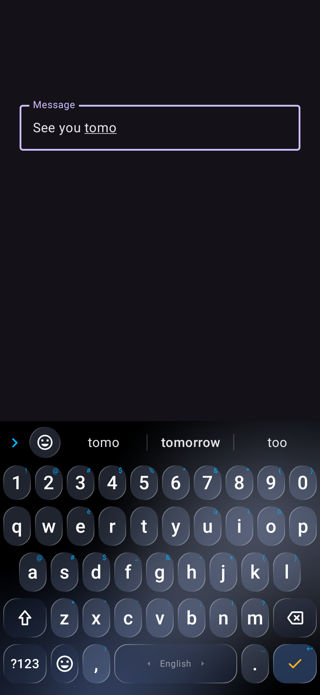
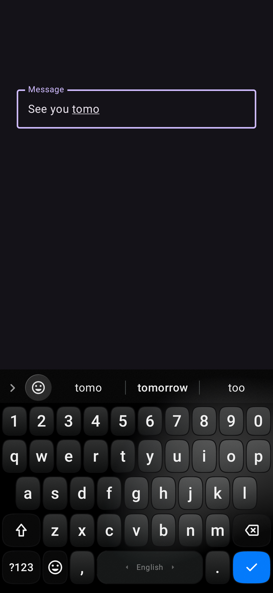

<!-- Generated by bot/src/cli/generate.ts from addons/*/*/meta.json. Do not edit by hand. -->

  
  <h1>WM Keyboard Community</h1>
  
Themes and layouts made by people who use WM Keyboard.

WM Keyboard lists this repository under **Settings → Addons** on its own. To add it anywhere else, use `https://github.com/wasi-master/wmkeyboard-community-addons`, or browse it in the [web store](https://wmkeyboard.pages.dev/addons/?repo=https%3A%2F%2Fgithub.com%2Fwasi-master%2Fwmkeyboard-community-addons).

**Share yours:** use **Share to community** on a theme or in the layout editor, or open [Submit a theme](https://github.com/wasi-master/wmkeyboard-community-addons/issues/new?template=submit-theme.yml) / [Submit a layout](https://github.com/wasi-master/wmkeyboard-community-addons/issues/new?template=submit-layout.yml) here. A bot checks it and posts a preview; a maintainer publishes it. Details in [CONTRIBUTING.md](CONTRIBUTING.md).

## Themes

<table>
<tr>
<td valign="top" width="33%"> <b>FROSTKEY</b> by PrncDENZ254KE · CC-BY-4.0 · v1.0.0</td>
<td valign="top" width="33%"> <b>IoS Ash</b> by AshUchiha3 · CC0-1.0 · v1.0.0</td>
</tr>
</table>

## Layouts

None yet. Be the first: [submit one](https://github.com/wasi-master/wmkeyboard-community-addons/issues/new?template=submit-layout.yml).

---

2 addons, indexed by [`wmkeyboard-repo.json`](wmkeyboard-repo.json) (raw: `https://raw.githubusercontent.com/wasi-master/wmkeyboard-community-addons/main/wmkeyboard-repo.json`). Each addon is published under the licence on its card; the bot and tooling under `bot/` are MIT. Names and descriptions are limited to 60 and 500 characters.
