<!-- Generated by bot/src/cli/generate.ts from addons/*/*/meta.json. Do not edit by hand. -->

  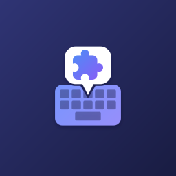
  <h1>WM Keyboard Community</h1>
  
Themes, layouts, icon packs, sticker packs, sound packs and snippets made by people who use WM Keyboard.

WM Keyboard lists this repository under **Settings → Addons** on its own. To add it anywhere else, use `https://github.com/wasi-master/wmkeyboard-community-addons`, [open it in the app](https://wmkeyboard.app/open/?repo=https%3A%2F%2Fgithub.com%2Fwasi-master%2Fwmkeyboard-community-addons), or browse it in the [web store](https://wmkeyboard.pages.dev/addons/?repo=https%3A%2F%2Fgithub.com%2Fwasi-master%2Fwmkeyboard-community-addons).

**Share yours:** use **Share with everyone** in the app (on a theme, a layout, an icon pack, a sticker pack or your snippets) or **Submit to community** in the web store's builders, or open one of the forms here: [theme](https://github.com/wasi-master/wmkeyboard-community-addons/issues/new?template=submit-theme.yml) · [layout](https://github.com/wasi-master/wmkeyboard-community-addons/issues/new?template=submit-layout.yml) · [icon pack](https://github.com/wasi-master/wmkeyboard-community-addons/issues/new?template=submit-icon-pack.yml) · [sticker pack](https://github.com/wasi-master/wmkeyboard-community-addons/issues/new?template=submit-stickers.yml) · [sound pack](https://github.com/wasi-master/wmkeyboard-community-addons/issues/new?template=submit-sound-pack.yml) · [snippet pack](https://github.com/wasi-master/wmkeyboard-community-addons/issues/new?template=submit-snippets.yml). A bot checks it and posts a preview; a maintainer publishes it. Details in [CONTRIBUTING.md](CONTRIBUTING.md).

## Themes

<table>
<tr>
<td valign="top" width="33%"><a href="addons/themes/rounded">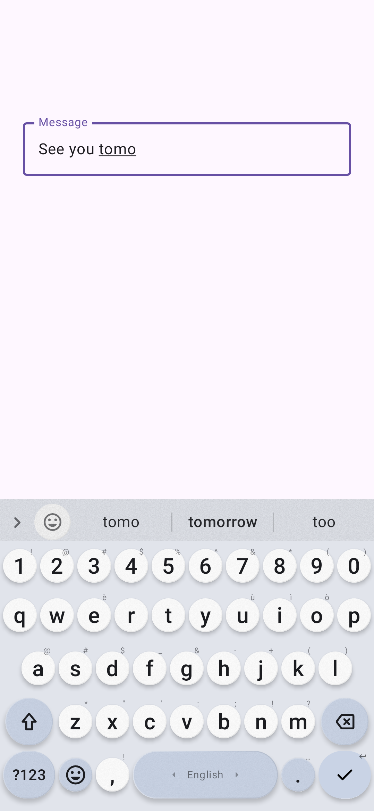</a> <b>Rounded</b> by kawoser · CC0-1.0 · v1.0.0</td>
<td valign="top" width="33%"><a href="addons/themes/retro">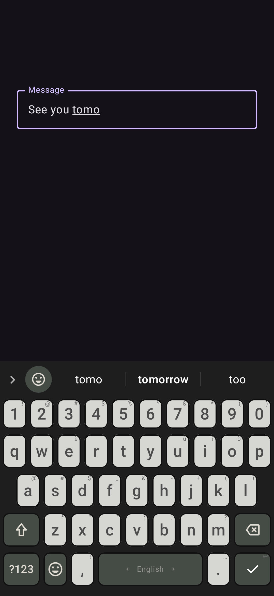</a> <b>Retro</b> by xyz12344 · CC-BY-4.0 · v1.0.0</td>
<td valign="top" width="33%"><a href="addons/themes/gboard-pink">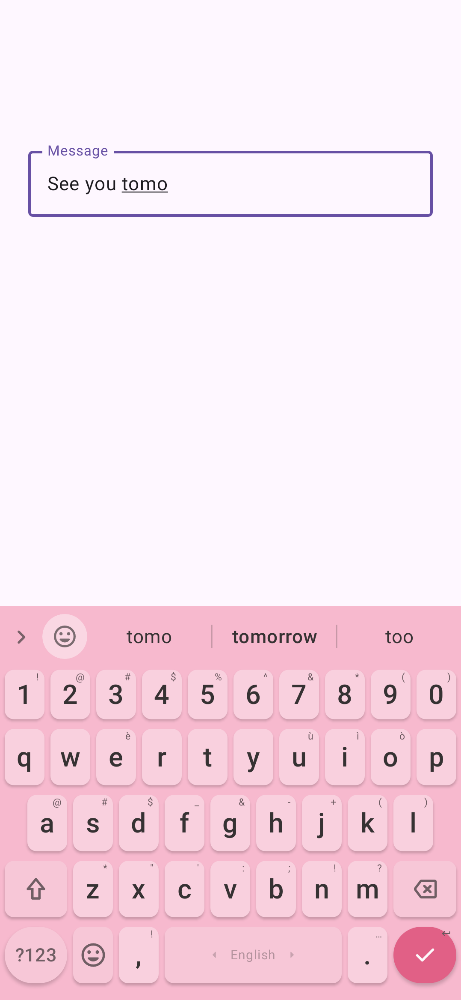</a> <b>Gboard pink</b> by xyz12344 · CC0-1.0 · v1.0.0</td>
</tr>
<tr>
<td valign="top" width="33%"><a href="addons/themes/metal-light-ash">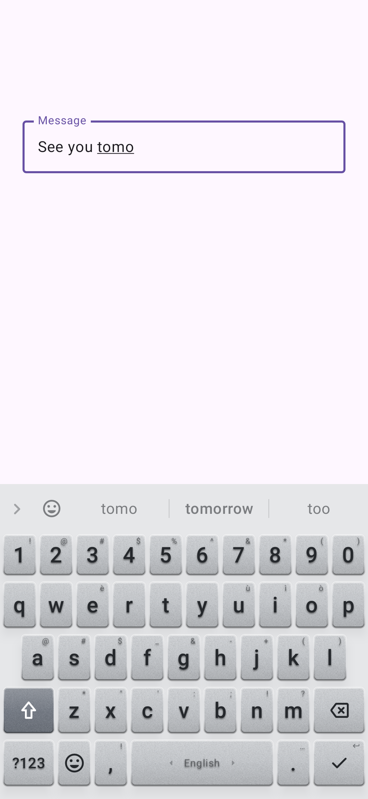</a> <b>Metal Light - Ash</b> by AshUchiha3 · CC-BY-4.0 · v1.0.0</td>
<td valign="top" width="33%"><a href="addons/themes/my-novelkeys-light">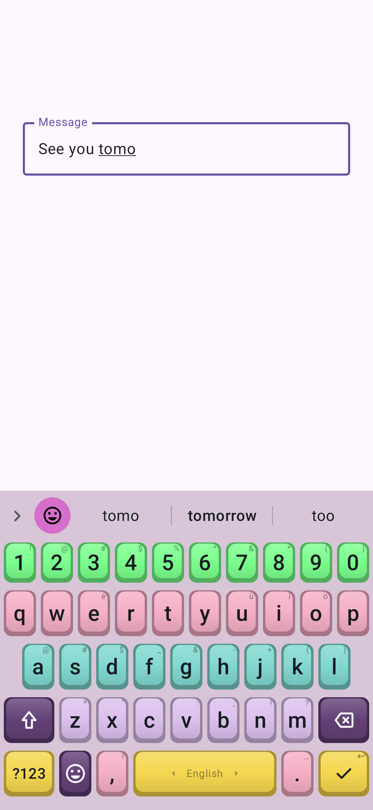</a> <b>My NovelKeys Light</b> by xyz12344 · CC-BY-4.0 · v1.0.0 remix of clink.anti-ltd.clink-themes-unofficial/novelkeys-light</td>
<td valign="top" width="33%"><a href="addons/themes/pastle-punk">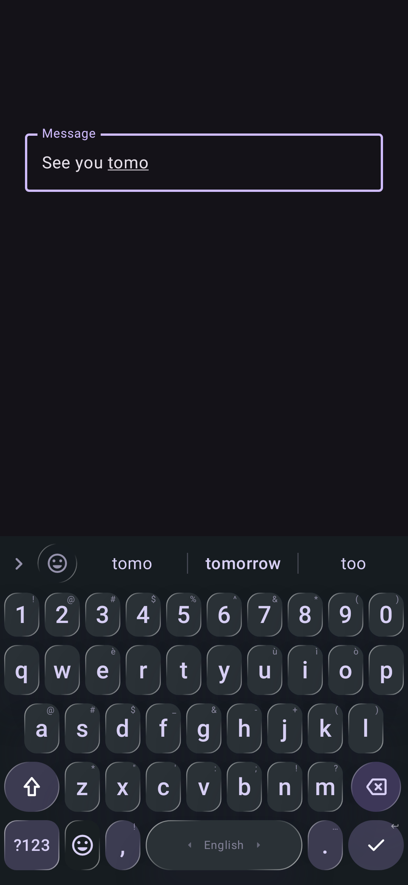</a> <b>Pastle Punk</b> by mini-page · CC0-1.0 · v1.1.0</td>
</tr>
<tr>
<td valign="top" width="33%"><a href="addons/themes/greyish-ash">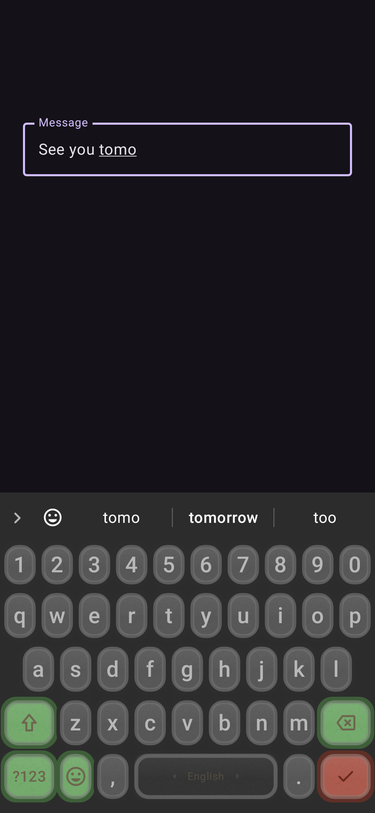</a> <b>Greyish Ash</b> by AshUchiha3 · CC-BY-4.0 · v1.0.0</td>
<td valign="top" width="33%"><a href="addons/themes/icy-cold-ash">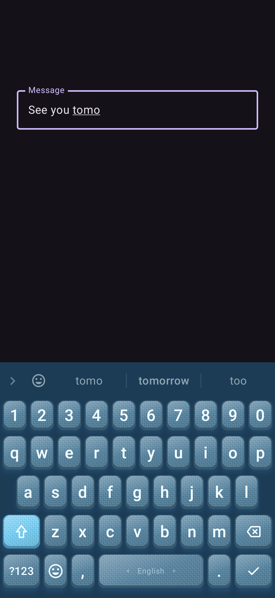</a> <b>ICY COLD ASH</b> by AshUchiha3 · CC-BY-4.0 · v1.0.0</td>
<td valign="top" width="33%"><a href="addons/themes/carbon-glass">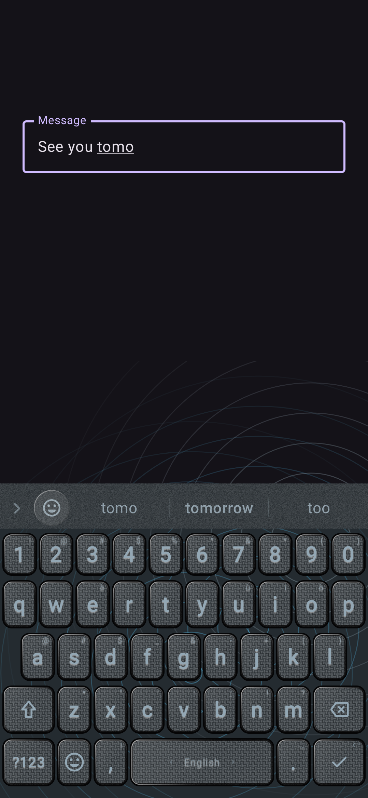</a> <b>CARBON GLASS</b> by xyz12344 · CC-BY-4.0 · v1.0.0</td>
</tr>
<tr>
<td valign="top" width="33%"><a href="addons/themes/marble">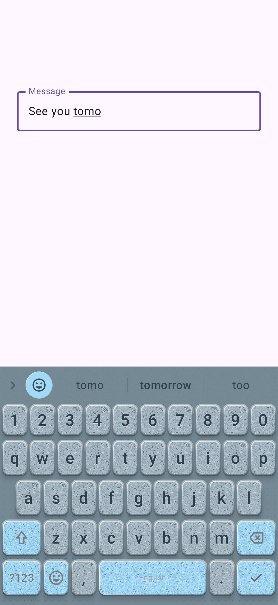</a> <b>Marble</b> by xyz12344 · CC-BY-SA-4.0 · v1.0.0</td>
<td valign="top" width="33%"><a href="addons/themes/cloth-ash">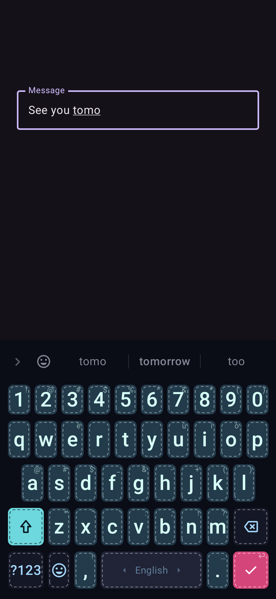</a> <b>Cloth - Ash</b> by AshUchiha3 · CC-BY-4.0 · v1.0.0</td>
<td valign="top" width="33%"><a href="addons/themes/somewhat-metal-ash">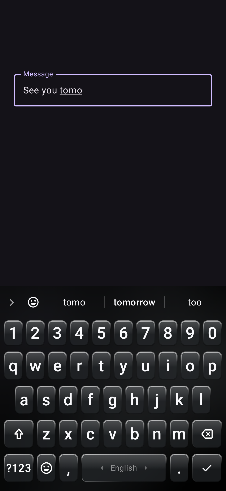</a> <b>Somewhat Metal - Ash</b> by AshUchiha3 · CC-BY-4.0 · v1.0.0</td>
</tr>
<tr>
<td valign="top" width="33%"><a href="addons/themes/pureline-theme-amoled">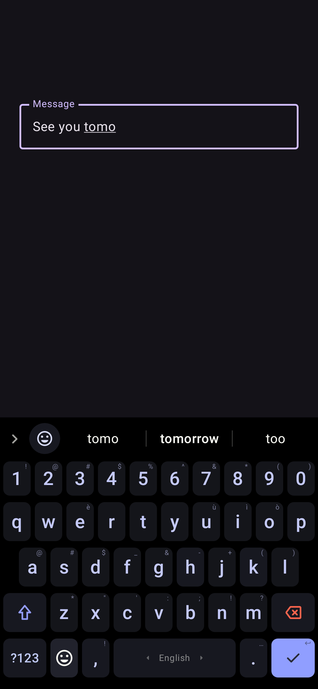</a> <b>Pureline Theme \[Amoled\]V2</b> by Episode12 · CC-BY-4.0 · v1.1.0</td>
<td valign="top" width="33%"><a href="addons/themes/rounded-pill-ash">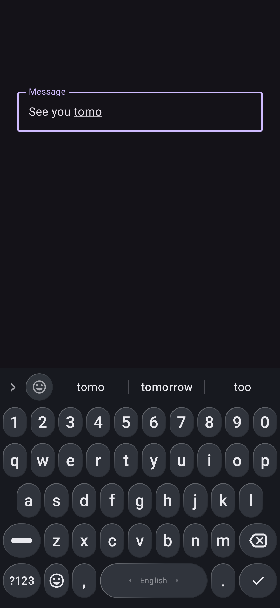</a> <b>Rounded Pill Ash</b> by AshUchiha3 · CC-BY-4.0 · v1.0.0</td>
<td valign="top" width="33%"><a href="addons/themes/rainbow-background">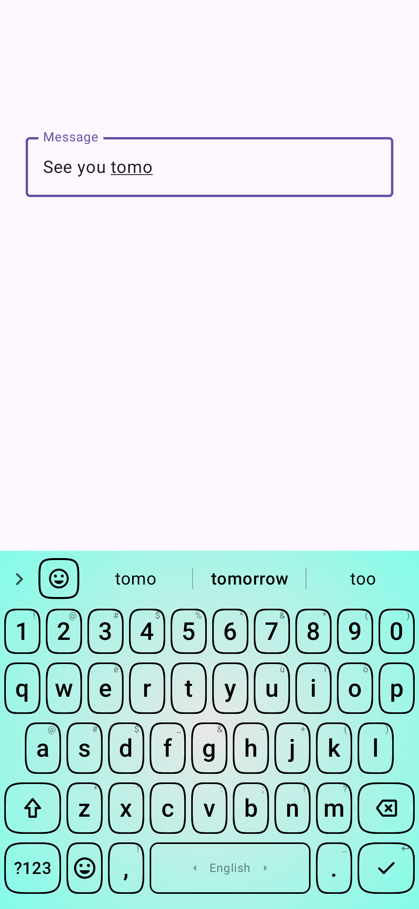</a> <b>Rainbow background</b> by xyz12344 · CC-BY-4.0 · v1.0.0</td>
</tr>
<tr>
<td valign="top" width="33%"><a href="addons/themes/light-green-border">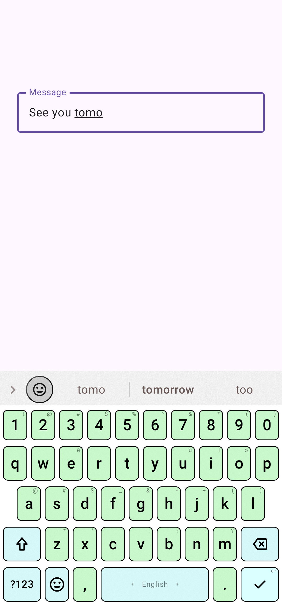</a> <b>light green border</b> by xyz12344 · CC-BY-4.0 · v1.0.0</td>
<td valign="top" width="33%"><a href="addons/themes/materail-moment">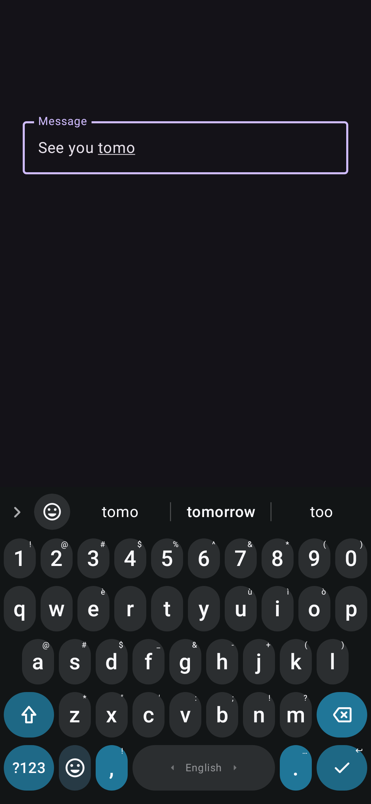</a> <b>Materail Moment</b> by mini-page · CC0-1.0 · v1.0.0</td>
<td valign="top" width="33%"><a href="addons/themes/ios-dark-glass-ash">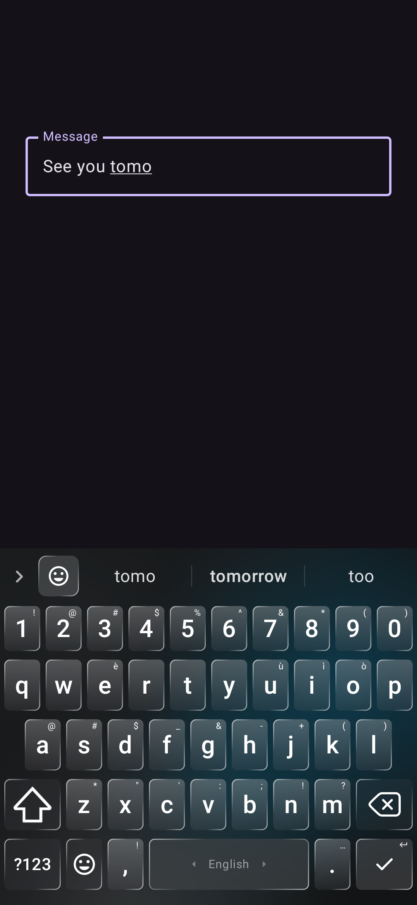</a> <b>iOS Dark Glass Ash</b> by AshUchiha3 · CC0-1.0 · v1.0.0</td>
</tr>
<tr>
<td valign="top" width="33%"><a href="addons/themes/mono-frosted-glass">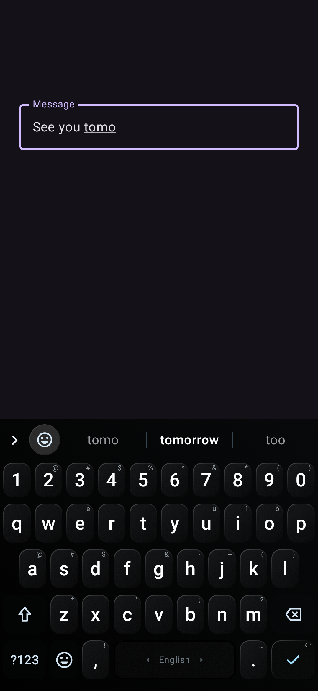</a> <b>Mono Frosted Glass</b> by Veratian · CC0-1.0 · v1.0.0</td>
<td valign="top" width="33%"><a href="addons/themes/degradado-escarcha">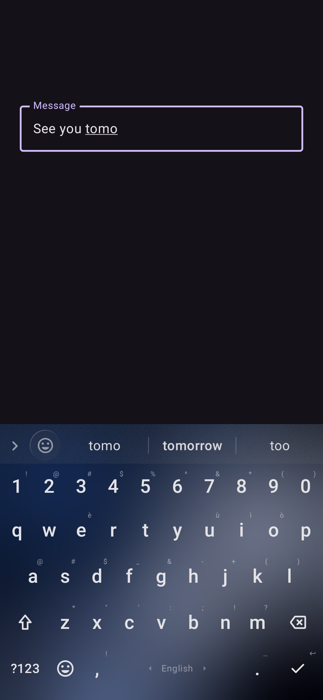</a> <b>Degradado escarcha</b> by titomdp06-cmyk · CC-BY-4.0 · v1.0.0</td>
<td valign="top" width="33%"><a href="addons/themes/lo-fi-anime-girl">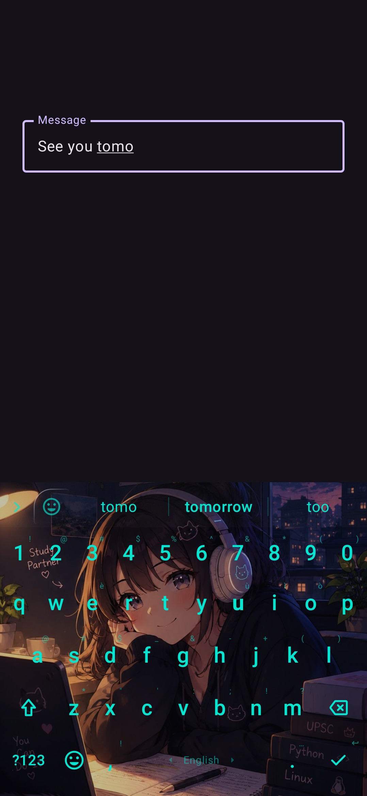</a> <b>Lo-fi Anime girl</b> by mishrapriyanshu7191-blip · CC0-1.0 · v1.0.0</td>
</tr>
<tr>
<td valign="top" width="33%"><a href="addons/themes/nothing-keyboard-v1">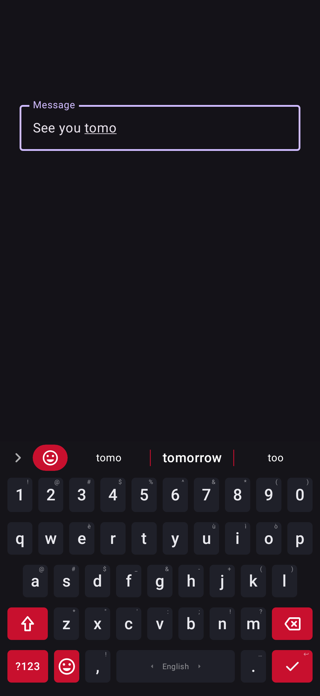</a> <b>NOTHING Keyboard V1</b> by MystiKitsu · CC-BY-4.0 · v1.0.0</td>
<td valign="top" width="33%"><a href="addons/themes/frostkey">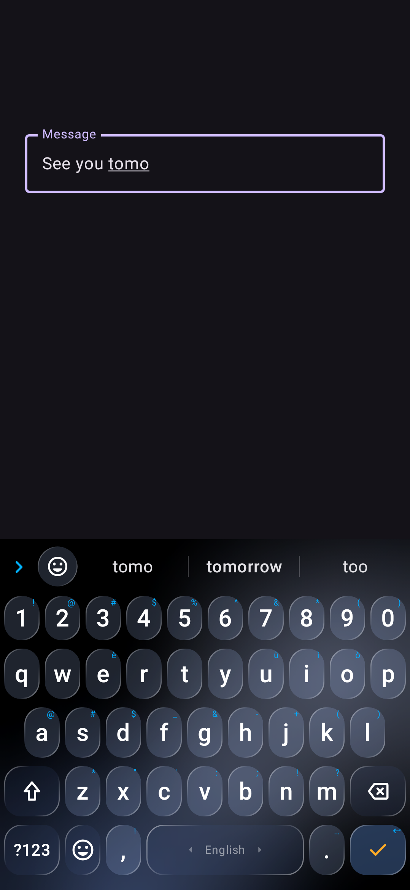</a> <b>FROSTKEY</b> by PrncDENZ254KE · CC-BY-4.0 · v1.0.0</td>
<td valign="top" width="33%"><a href="addons/themes/ios-ash">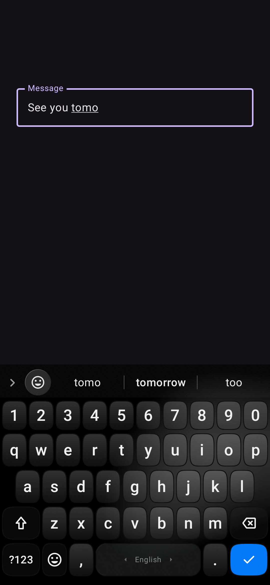</a> <b>IoS Ash</b> by AshUchiha3 · CC0-1.0 · v1.0.0</td>
</tr>
</table>

## Layouts

<table>
<tr>
<td valign="top" width="33%"><a href="addons/layouts/futo-keyboard-symbol-layout">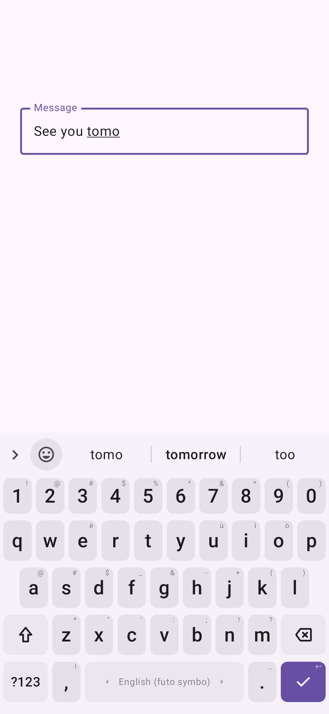</a> <b>Futo keyboard symbol layout</b> by kochurmatha-cpu · CC0-1.0 · v1.0.0</td>
<td valign="top" width="33%"><a href="addons/layouts/quickedit-gboard-symbols">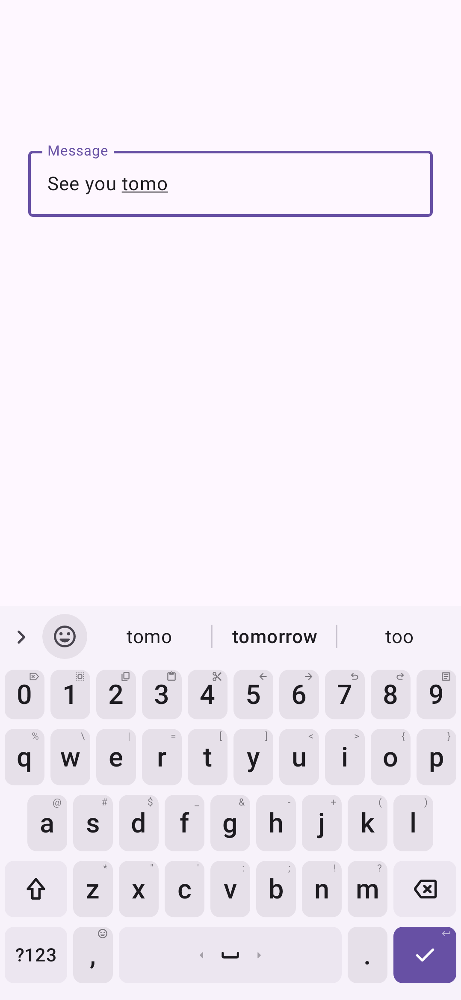</a> <b>quickedit\+gboard Symbols</b> by xyz12344 · CC-BY-4.0 · v1.0.0</td>
<td valign="top" width="33%"><a href="addons/layouts/hindi-marathi-devanagari">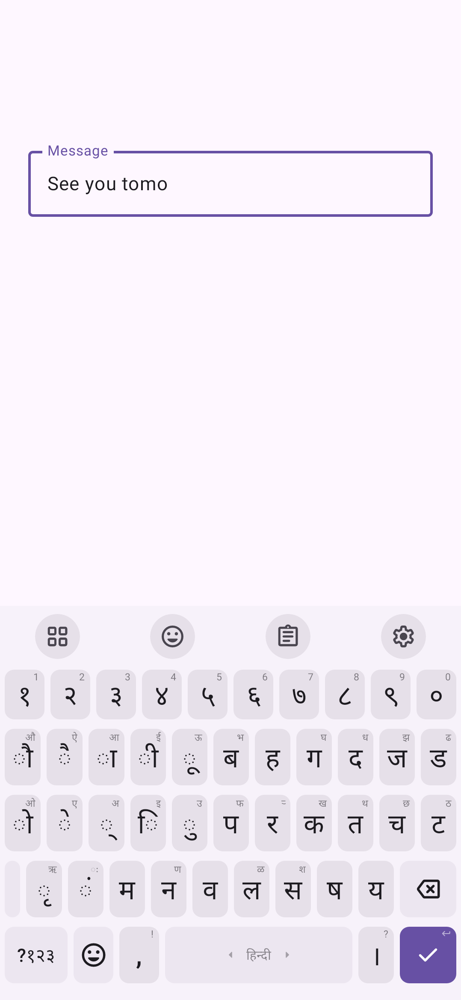</a> <b>Hindi / Marathi \(Devanagari\)</b> by RamPawar7 · CC0-1.0 · v1.0.0</td>
</tr>
</table>

## Icon packs

<table>
<tr>
<td valign="top" width="33%"><a href="addons/icon-packs/pureline-icon-pack">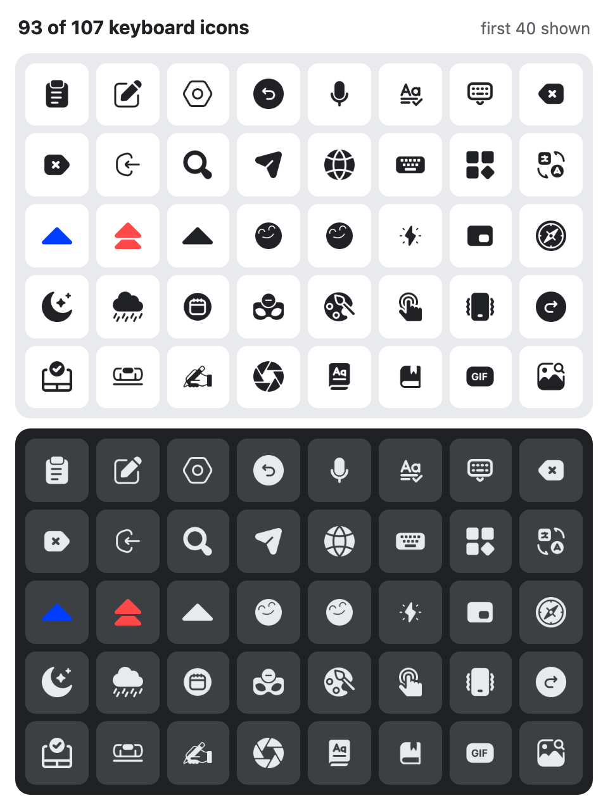</a> <b>Pureline Icon pack</b> by Episode12 · CC-BY-4.0 · v1.0.0</td>
</tr>
</table>

## Sticker packs

None yet. Be the first: [submit one](https://github.com/wasi-master/wmkeyboard-community-addons/issues/new?template=submit-stickers.yml).

## Sound packs

None yet. Be the first: [submit one](https://github.com/wasi-master/wmkeyboard-community-addons/issues/new?template=submit-sound-pack.yml).

## Snippets

None yet. Be the first: [submit one](https://github.com/wasi-master/wmkeyboard-community-addons/issues/new?template=submit-snippets.yml).

## Open in WM Keyboard

On a phone with WM Keyboard, these links go straight to the addon's page in the app, where you tap Install. Elsewhere they open a page with an **Open in WM Keyboard** button.

| Addon | Type | By | Open in app |
|---|---|---|---|
| [Rounded](addons/themes/rounded) | theme | kawoser | [Open](https://wmkeyboard.app/open/?repo=https%3A%2F%2Fgithub.com%2Fwasi-master%2Fwmkeyboard-community-addons&id=rounded) |
| [Retro](addons/themes/retro) | theme | xyz12344 | [Open](https://wmkeyboard.app/open/?repo=https%3A%2F%2Fgithub.com%2Fwasi-master%2Fwmkeyboard-community-addons&id=retro) |
| [Gboard pink](addons/themes/gboard-pink) | theme | xyz12344 | [Open](https://wmkeyboard.app/open/?repo=https%3A%2F%2Fgithub.com%2Fwasi-master%2Fwmkeyboard-community-addons&id=gboard-pink) |
| [Metal Light - Ash](addons/themes/metal-light-ash) | theme | AshUchiha3 | [Open](https://wmkeyboard.app/open/?repo=https%3A%2F%2Fgithub.com%2Fwasi-master%2Fwmkeyboard-community-addons&id=metal-light-ash) |
| [My NovelKeys Light](addons/themes/my-novelkeys-light) | theme | xyz12344 | [Open](https://wmkeyboard.app/open/?repo=https%3A%2F%2Fgithub.com%2Fwasi-master%2Fwmkeyboard-community-addons&id=my-novelkeys-light) |
| [Pastle Punk](addons/themes/pastle-punk) | theme | mini-page | [Open](https://wmkeyboard.app/open/?repo=https%3A%2F%2Fgithub.com%2Fwasi-master%2Fwmkeyboard-community-addons&id=pastle-punk) |
| [Greyish Ash](addons/themes/greyish-ash) | theme | AshUchiha3 | [Open](https://wmkeyboard.app/open/?repo=https%3A%2F%2Fgithub.com%2Fwasi-master%2Fwmkeyboard-community-addons&id=greyish-ash) |
| [ICY COLD ASH](addons/themes/icy-cold-ash) | theme | AshUchiha3 | [Open](https://wmkeyboard.app/open/?repo=https%3A%2F%2Fgithub.com%2Fwasi-master%2Fwmkeyboard-community-addons&id=icy-cold-ash) |
| [CARBON GLASS](addons/themes/carbon-glass) | theme | xyz12344 | [Open](https://wmkeyboard.app/open/?repo=https%3A%2F%2Fgithub.com%2Fwasi-master%2Fwmkeyboard-community-addons&id=carbon-glass) |
| [Marble](addons/themes/marble) | theme | xyz12344 | [Open](https://wmkeyboard.app/open/?repo=https%3A%2F%2Fgithub.com%2Fwasi-master%2Fwmkeyboard-community-addons&id=marble) |
| [Cloth - Ash](addons/themes/cloth-ash) | theme | AshUchiha3 | [Open](https://wmkeyboard.app/open/?repo=https%3A%2F%2Fgithub.com%2Fwasi-master%2Fwmkeyboard-community-addons&id=cloth-ash) |
| [Somewhat Metal - Ash](addons/themes/somewhat-metal-ash) | theme | AshUchiha3 | [Open](https://wmkeyboard.app/open/?repo=https%3A%2F%2Fgithub.com%2Fwasi-master%2Fwmkeyboard-community-addons&id=somewhat-metal-ash) |
| [Pureline Theme \[Amoled\]V2](addons/themes/pureline-theme-amoled) | theme | Episode12 | [Open](https://wmkeyboard.app/open/?repo=https%3A%2F%2Fgithub.com%2Fwasi-master%2Fwmkeyboard-community-addons&id=pureline-theme-amoled) |
| [Rounded Pill Ash](addons/themes/rounded-pill-ash) | theme | AshUchiha3 | [Open](https://wmkeyboard.app/open/?repo=https%3A%2F%2Fgithub.com%2Fwasi-master%2Fwmkeyboard-community-addons&id=rounded-pill-ash) |
| [Rainbow background](addons/themes/rainbow-background) | theme | xyz12344 | [Open](https://wmkeyboard.app/open/?repo=https%3A%2F%2Fgithub.com%2Fwasi-master%2Fwmkeyboard-community-addons&id=rainbow-background) |
| [light green border](addons/themes/light-green-border) | theme | xyz12344 | [Open](https://wmkeyboard.app/open/?repo=https%3A%2F%2Fgithub.com%2Fwasi-master%2Fwmkeyboard-community-addons&id=light-green-border) |
| [Materail Moment](addons/themes/materail-moment) | theme | mini-page | [Open](https://wmkeyboard.app/open/?repo=https%3A%2F%2Fgithub.com%2Fwasi-master%2Fwmkeyboard-community-addons&id=materail-moment) |
| [iOS Dark Glass Ash](addons/themes/ios-dark-glass-ash) | theme | AshUchiha3 | [Open](https://wmkeyboard.app/open/?repo=https%3A%2F%2Fgithub.com%2Fwasi-master%2Fwmkeyboard-community-addons&id=ios-dark-glass-ash) |
| [Mono Frosted Glass](addons/themes/mono-frosted-glass) | theme | Veratian | [Open](https://wmkeyboard.app/open/?repo=https%3A%2F%2Fgithub.com%2Fwasi-master%2Fwmkeyboard-community-addons&id=mono-frosted-glass) |
| [Degradado escarcha](addons/themes/degradado-escarcha) | theme | titomdp06-cmyk | [Open](https://wmkeyboard.app/open/?repo=https%3A%2F%2Fgithub.com%2Fwasi-master%2Fwmkeyboard-community-addons&id=degradado-escarcha) |
| [Lo-fi Anime girl](addons/themes/lo-fi-anime-girl) | theme | mishrapriyanshu7191-blip | [Open](https://wmkeyboard.app/open/?repo=https%3A%2F%2Fgithub.com%2Fwasi-master%2Fwmkeyboard-community-addons&id=lo-fi-anime-girl) |
| [NOTHING Keyboard V1](addons/themes/nothing-keyboard-v1) | theme | MystiKitsu | [Open](https://wmkeyboard.app/open/?repo=https%3A%2F%2Fgithub.com%2Fwasi-master%2Fwmkeyboard-community-addons&id=nothing-keyboard-v1) |
| [FROSTKEY](addons/themes/frostkey) | theme | PrncDENZ254KE | [Open](https://wmkeyboard.app/open/?repo=https%3A%2F%2Fgithub.com%2Fwasi-master%2Fwmkeyboard-community-addons&id=frostkey) |
| [IoS Ash](addons/themes/ios-ash) | theme | AshUchiha3 | [Open](https://wmkeyboard.app/open/?repo=https%3A%2F%2Fgithub.com%2Fwasi-master%2Fwmkeyboard-community-addons&id=ios-ash) |
| [Futo keyboard symbol layout](addons/layouts/futo-keyboard-symbol-layout) | layout | kochurmatha-cpu | [Open](https://wmkeyboard.app/open/?repo=https%3A%2F%2Fgithub.com%2Fwasi-master%2Fwmkeyboard-community-addons&id=futo-keyboard-symbol-layout) |
| [quickedit\+gboard Symbols](addons/layouts/quickedit-gboard-symbols) | layout | xyz12344 | [Open](https://wmkeyboard.app/open/?repo=https%3A%2F%2Fgithub.com%2Fwasi-master%2Fwmkeyboard-community-addons&id=quickedit-gboard-symbols) |
| [Hindi / Marathi \(Devanagari\)](addons/layouts/hindi-marathi-devanagari) | layout | RamPawar7 | [Open](https://wmkeyboard.app/open/?repo=https%3A%2F%2Fgithub.com%2Fwasi-master%2Fwmkeyboard-community-addons&id=hindi-marathi-devanagari) |
| [Pureline Icon pack](addons/icon-packs/pureline-icon-pack) | icon pack | Episode12 | [Open](https://wmkeyboard.app/open/?repo=https%3A%2F%2Fgithub.com%2Fwasi-master%2Fwmkeyboard-community-addons&id=pureline-icon-pack) |

---

28 addons, indexed by [`wmkeyboard-repo.json`](wmkeyboard-repo.json) (raw: `https://raw.githubusercontent.com/wasi-master/wmkeyboard-community-addons/main/wmkeyboard-repo.json`). Each addon is published under the licence on its card; the bot and tooling under `bot/` are MIT. Names and descriptions are limited to 60 and 500 characters.
